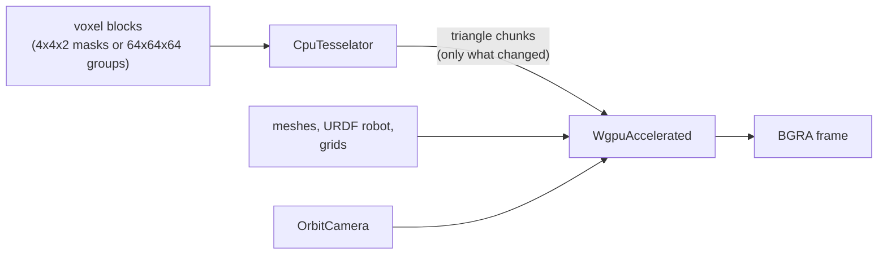

<p align="center">
  
</p>

<h1 align="center">r3v-renderer</h1>

<p align="center">
  Headless GPU renderer for voxel maps and URDF robots.<br>
  Rust library with C, C++, Python and JavaScript bindings.
</p>

<p align="center">
  <a href="https://github.com/igorosky/r3v-renderer/actions/workflows/ci.yml"></a>
  <a href="https://igorosky.github.io/r3v-renderer/"></a>
</p>

---

r3v-renderer draws a voxel map together with robot models into an image
buffer. It needs no window: you feed it voxels and meshes, give it a camera
and get a frame back, ready to be sent as a video stream or saved to a file.

The voxels usually come from
[r3v-voxelizer](https://github.com/igorosky/r3v-voxelizer): its compressed
output (4x4x2 voxel blocks) goes straight into the tesselator here.



## Features

- **Incremental tessellation.** The map is split into chunks and only changed
  chunks are rebuilt and uploaded. Optional marching cubes smooths the surface.
- **Frustum culling.** Chunks outside the camera view are skipped.
- **Colormaps.** Voxels are colored by distance from the camera (turbo) or by
  height (hypsometric, continuous or in bands).
- **Robots and meshes.** URDF robots posed from joint values, STL and OBJ
  meshes, box, cylinder, sphere and capsule primitives, colors and textures.
- **Grids.** Line grids in the world or attached to a robot link.
- **Runs anywhere wgpu does.** Vulkan, Metal, DX12 or WebGPU, and on the CPU
  with the lavapipe software driver.
- **Bindings** for C, C++, Python and JavaScript (WebAssembly + WebGPU).

## Quick start

Add the crate (it is not on crates.io yet) and `cgmath` for the camera target:

```toml
[dependencies]
r3v-renderer = { git = "https://github.com/igorosky/r3v-renderer" }
cgmath = "0.18"
```

```rust
use cgmath::Point3;
use r3v_renderer::camera::OrbitCamera;
use r3v_renderer::geometry::PointI;
use r3v_renderer::renderer::{
    DEFAULT_COLOR_DEPTH_RANGE, TerrainColoring, WgpuAccelerated, WgpuAcceleratedConfiguration,
};
use r3v_renderer::tesselator::{
    CpuTesselator, CpuTesselatorConfiguration, CpuTesselatorContext,
};
use r3v_renderer::{Camera, Renderer, Tesselator};

const WIDTH: u32 = 320;
const HEIGHT: u32 = 240;

fn main() {
    let mut renderer = WgpuAccelerated::new().expect("no GPU adapter");
    renderer.configure(WgpuAcceleratedConfiguration {
        width: WIDTH,
        height: HEIGHT,
        background_color: [0.0, 0.0, 0.0],
        color_depth_range: DEFAULT_COLOR_DEPTH_RANGE,
        terrain_coloring: TerrainColoring::default(),
    });

    // Voxels come as 4x4x2 blocks with a 32 bit occupancy mask, for example
    // straight from r3v-voxelizer. Here: a row of 8 full blocks.
    let mut tesselator = CpuTesselator::new();
    tesselator.configure(CpuTesselatorConfiguration {
        voxel_size: 0.25,
        marching_cubes_enabled: false,
    });
    let blocks: Vec<PointI> = (0..8)
        .map(|k| PointI { x: 4 * k, y: 0, z: 0, i: u32::MAX })
        .collect();
    tesselator.update_input_geometry(&blocks);

    let context = CpuTesselatorContext { camera_frustum: None };
    while let Some(delta) = tesselator.get_output_geometry_delta(&context) {
        renderer.update_geometry(delta);
    }

    let camera = OrbitCamera::new(Point3::new(4.0, 1.0, 1.0), 12.0, 30.0, 25.0);
    let state = camera.get_state(WIDTH as f32 / HEIGHT as f32);
    let mut frame = vec![0u8; (WIDTH * HEIGHT * 4) as usize];
    renderer.render(&state, &mut frame);
    renderer.render(&state, &mut frame); // frames come back one call late
    // `frame` now holds BGRA pixels, rows from the top.
}
```

### Good to know

- Frames are **BGRA**, 8 bit sRGB, rows from the top, no padding. The JS
  binding also has `render_rgba`.
- Frames come back **one call late**: the first `render` (and the first one
  after a size change) gives zeros. Keep calling it in a loop, or call it twice
  for a single image.
- The world is **Y up**. URDF is Z up, so robots need a rotation.

## Other languages

| Language | Build | You get |
|---|---|---|
| C | `cargo build --release --features c` | `target/release/libr3v_renderer.so`, header `bindings/r3v-renderer.h` |
| C++ | `cargo build --release --features cpp` | `target/release/libr3v_renderer.so`, header `bindings/r3v-renderer.hpp` |
| Python | `cargo build --release --features python` | `target/release/libr3v_renderer.so`, rename it to `r3v_renderer.so`; type stubs in `bindings/r3v_renderer.pyi` |
| JavaScript | `wasm-pack build --release --target web --features js` | `pkg/` with the module and TypeScript types |

Add `multi-threaded` (C, C++, Python) to tessellate on several threads.

Every language has a full example in `examples/` that renders a small
staircase of voxels to a PPM image. The build and run commands are at the top
of each file.

<details>
<summary><b>Python</b></summary>

```python
import r3v_renderer as rr

renderer = rr.WgpuRenderer()
renderer.configure(rr.WgpuRendererConfiguration(320, 240))

tesselator = rr.CpuTesselator()
tesselator.configure(rr.CpuTesselatorConfiguration(voxel_size=0.25))
tesselator.update_input_geometry(rr.PointI(4 * k, 0, 0, 2**32 - 1) for k in range(8))
delta = tesselator.get_output_geometry_delta()
if delta is not None:
    renderer.update_geometry(delta)

camera = rr.OrbitCamera(target=(4, 1, 1), distance=12, yaw_deg=30, pitch_deg=25)
state = camera.get_state(320 / 240)
frame = bytearray(320 * 240 * 4)  # BGRA
renderer.render(state, frame)
renderer.render(state, frame)
```

Full example: [`examples/python/voxels_to_ppm.py`](examples/python/voxels_to_ppm.py)
</details>

<details>
<summary><b>C</b></summary>

```c
#include "r3v-renderer.h"

R3vWgpuRenderer *renderer = r3v_wgpu_renderer_create();  /* NULL on failure */
R3vWgpuRendererConfiguration configuration = {320, 240, {0.0f, 0.0f, 0.0f}, 50.0f,
                                              r3v_terrain_coloring_default()};
r3v_wgpu_renderer_configure(renderer, configuration);

R3vCpuTesselator *tesselator = r3v_cpu_tesselator_create();
R3vCpuTesselatorConfiguration tesselator_configuration = {0.25f, false};
r3v_cpu_tesselator_configure(tesselator, tesselator_configuration);
R3vPointI block = {0, 0, 0, UINT32_MAX};
r3v_cpu_tesselator_update_input_geometry(tesselator, &block, 1);
R3vGeometryDelta *delta = NULL;
r3v_cpu_tesselator_get_output_geometry_delta(tesselator, NULL, &delta);
if (delta != NULL) r3v_wgpu_renderer_update_geometry(renderer, delta);  /* takes the delta */

R3vOrbitCamera camera = r3v_orbit_camera_new((R3vVec3){4.0f, 1.0f, 1.0f}, 12.0f, 30.0f, 25.0f);
R3vCameraState state;
r3v_orbit_camera_get_state(camera, 320.0f / 240.0f, &state);
static uint8_t frame[320 * 240 * 4];  /* BGRA */
r3v_wgpu_renderer_render(renderer, &state, frame, sizeof frame);
r3v_wgpu_renderer_render(renderer, &state, frame, sizeof frame);

r3v_cpu_tesselator_drop(tesselator);
r3v_wgpu_renderer_drop(renderer);
```

Every function returns an `R3vStatus` (or NULL for a handle); the reason of a
failure is in `r3v_renderer_last_error()`. Full example with error checks:
[`examples/c/voxels_to_ppm.c`](examples/c/voxels_to_ppm.c)
</details>

<details>
<summary><b>JavaScript</b></summary>

```js
import init, * as rr from "./pkg/r3v_renderer.js";

await init();
const renderer = await rr.WgpuRenderer.create();
renderer.configure(new rr.WgpuRendererConfiguration(320, 240));

const tesselator = new rr.CpuTesselator();
tesselator.configure(new rr.CpuTesselatorConfiguration(0.25));
tesselator.update_input_geometry([{ x: 0, y: 0, z: 0, i: 2 ** 32 - 1 }]);
const delta = tesselator.get_output_geometry_delta();
if (delta !== undefined) renderer.update_geometry(delta);

const state = new rr.OrbitCamera([4, 1, 1], 12, 30, 25).get_state(320 / 240);
const frame = new Uint8ClampedArray(320 * 240 * 4);
await renderer.render_rgba(state, frame);  // RGBA, ready for ImageData
await renderer.render_rgba(state, frame);
```

Full example (runs on Node.js with the `webgpu` package):
[`examples/js/voxels_to_ppm.mjs`](examples/js/voxels_to_ppm.mjs)
</details>

Naming, error handling and async rules per language are in
[docs/bindings.md](docs/bindings.md).

## Demo

An interactive window with a generated voxel world and a robot driving
around:

```bash
cargo run --release --features demo -- path/to/robot.urdf
```

Mouse orbits, pans and zooms, keys switch marching cubes, culling, colormaps
and grids. See [docs/demo.md](docs/demo.md) for every control.

## Documentation

| Document | What is inside |
|---|---|
| [docs/guide.md](docs/guide.md) | How the pieces work: voxel input, tesselator, renderer settings, meshes, robots, grids, camera |
| [docs/bindings.md](docs/bindings.md) | C, C++, Python and JavaScript details |
| [docs/demo.md](docs/demo.md) | The demo window and its controls |

## Development

```bash
./test.sh                 # clippy (warnings are errors) and tests, every group
./test.sh core            # one group: core, c, python or js
cargo fmt --all --check
./coverage.sh             # line coverage, lcov files in target/coverage
cargo bench --bench frustum_culling
```

- Every group needs a GPU. The software Vulkan driver lavapipe
  (`mesa-vulkan-drivers`) is enough.
- `c` needs a C and C++ compiler, `python` needs `python3`, `js` needs
  `wasm-pack`, the `wasm32-unknown-unknown` target, Node and `npm ci` in
  `tests/js`. The binding tests also build and run the examples.
- Builds with `c` or `cpp` regenerate the headers in `bindings/`. Commit them,
  CI checks they are up to date.
- `c`/`cpp`, `python` and `js` cannot be combined in one build, and `js` does
  not work with `multi-threaded`.
- `coverage.sh` needs
  [cargo-llvm-cov](https://github.com/taiki-e/cargo-llvm-cov). It runs the
  tests and the C, C++ and Python binding suites (`./coverage.sh core` for one
  group). The JS suite is not measured, wasm can not be instrumented.
- The coverage report for master is at https://igorosky.github.io/r3v-renderer/.
  Pull requests with the `coverage` label get a summary comment and the
  report as a run artifact, plus a report of the changed lines.

## Part of r3v

| Repository | What it does |
|---|---|
| [r3v-voxelizer](https://github.com/igorosky/r3v-voxelizer) | Point clouds to occupancy voxel map |
| **r3v-renderer** | Headless renderer for the voxel map and robot models (this repository) |
| [r3v-ros](https://github.com/igorosky/r3v-ros) | ROS 2 nodes that put both together and publish images |
| [r3v-web](https://github.com/igorosky/r3v-web) | Browser viewer for the rendered stream |
